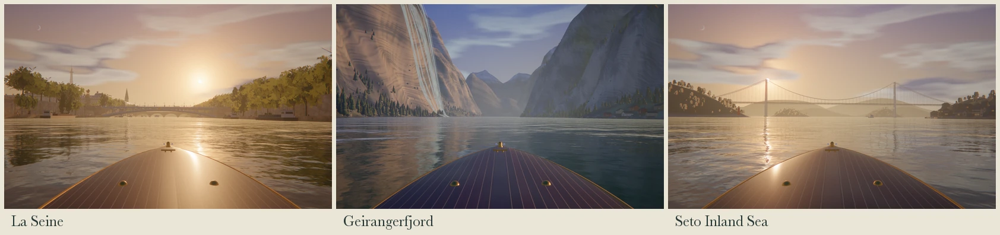
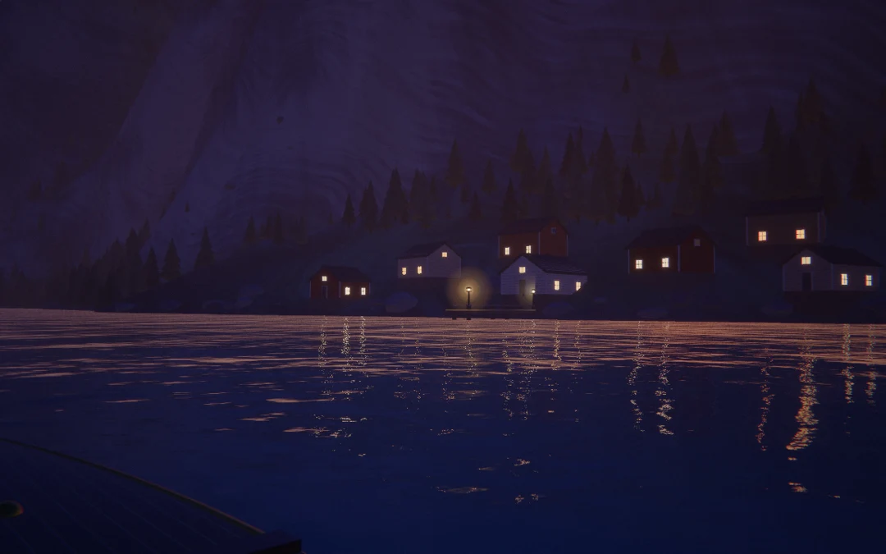

# Open Waters

[简体中文](README.md) · **English**

On the Seine, the shadow of a bridge passes over the bow. In Geirangerfjord, the water reflects steep rock walls and waterfalls. As the sky darkens, cabin windows and dock lamps come on one by one.



Open Waters is a first-person 3D boating game. Pick a waterway, step aboard a wooden boat, and spend seven minutes watching the sky go from gold to deep blue. The scenery is generated in code. The terrain and buildings draw on real places, with distances and layouts shaped for exploring by boat.

| Destination | What you can see from the boat | Voyage ID |
| --- | --- | --- |
| The Seine, France | Stone embankments, barges, Pont Alexandre III, and lights coming on along the river | `seine` |
| Geirangerfjord, Norway | Waterfalls down the rock faces, conifers on the slopes, and warm lights in the cabins and on the docks | `fjord` |
| Seto Inland Sea, Japan | Islands you can sail around, harbor lights, ferries, and a suspension bridge | `seto` |



## Run locally

Use Node.js 22.12 or a newer LTS release and a browser with WebGL 2 and floating-point render target support.

```sh
git clone https://github.com/carpediemzzsssww-cpu/open-waters.git
cd open-waters
npm ci
npm run dev
```

Open the local address printed in the terminal. Append `?voyage=seto` to go straight to the Seto Inland Sea. Run `npm run build` to generate the static site in `dist/`, then run `npm run preview` to preview it locally.

## Controls

The boat starts in cruise mode. Use **W / S** to adjust the throttle. Hold **S** to reverse. Use **A / D** to take the helm, and press **Space** to return to cruise mode. Drag to look around and scroll to zoom. On a phone, steer with the on-screen controls, pinch to zoom, and tap the helm icon to switch between manual steering and cruise.

Open the sunset control to change the season, jump to a point in dusk, or adjust how quickly time passes. Press **T** to pause or resume time, **M** to toggle sound, and **H** to hide the interface. Tap the map to choose another waterway. Each switch starts you at the new destination’s starting point.

## Add your own waterway

A destination builds the scenery and registers obstacles in the water. The engine handles the boat, steering, sky, water, reflections, and wake. Distances are in meters, the waterline is at `y = 0`, and the bow initially points along `−Z`.

1. Create `src/destinations/my-bay.ts` using the first example below. It places a reef beside the channel and sets its collision boundary.
2. Add the second example to the `voyages` array. It defines the destination’s name, starting point, and navigation bounds. [Destination catalog](src/destinations/catalog.ts)
3. Open `?voyage=my-bay` to take it out for a spin. The new destination appears on the departure screen and the in-game map.

```ts
// src/destinations/my-bay.ts
import * as THREE from 'three';
import { withAtmo } from '../core/atmosphere';
import { addCollider } from '../world/collide';
import type { Part, Progress, WorldContext } from '../world/build';

export async function build({ scene }: WorldContext, step: Progress): Promise<Part[]> {
  await step('Reef', 0.5);
  const rock = new THREE.Mesh(
    new THREE.SphereGeometry(1, 24, 16),
    withAtmo(new THREE.MeshStandardMaterial({ color: 0x807b70, roughness: 0.95 })),
  );
  rock.scale.set(7, 5, 7);
  rock.position.set(22, 0, -12);
  scene.add(rock);
  addCollider({ x: 22, z: -12, hw: 7, hl: 7, r: 7, yaw: 0 });
  return [];
}
```

```ts
// Add to voyages in src/destinations/catalog.ts
{
  id: 'my-bay',
  name: 'Stone Bay',
  localName: 'Stone Bay',
  region: 'Custom destination',
  description: 'Pass west of the reef.',
  navigation: { spawnX: 0, spawnZ: 90, halfWidth: 60, minZ: -200, maxZ: 200 },
  loadWorld: () => import('./my-bay'),
},
```

Use `waterTint` to scale the water’s RGB channels in linear color space and `sunBearing` to change the sunset’s angle relative to the course. Leave room near the center of the channel for the boat to turn around in cruise mode. To animate an object, have `build` return a part with `update(dt, time, camera)`. The `dt` argument is in seconds, and the ferries show how to use it. [Seto Inland Sea route](src/destinations/seto-route.ts)

The fjord lights follow the engine’s dusk clock. The scene builds the cabins, lit windows, and dock lamps, while the route update lets them fade in as the sky darkens. Open `?voyage=fjord&dusk=0.79&flow=0&x=56&z=-34&yaw=-43` to see that stretch of shore from the boat. [Fjord scene](src/destinations/fjord.ts) · [Route update](src/destinations/fjord-route.ts)

## License

Open Waters and three.js are licensed under MIT. [Project license](LICENSE) · [three.js license](public/three-LICENSE.txt)
