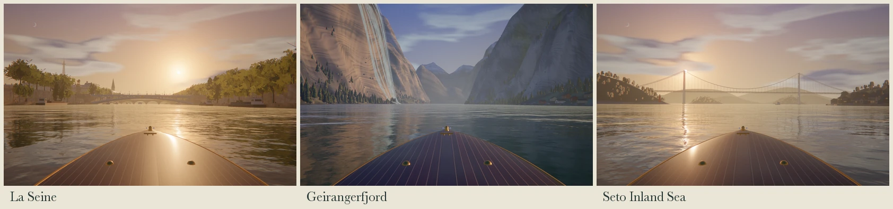
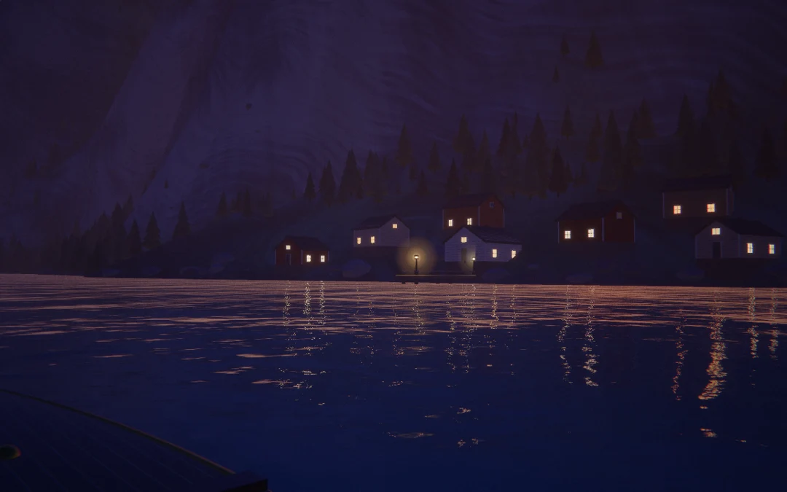
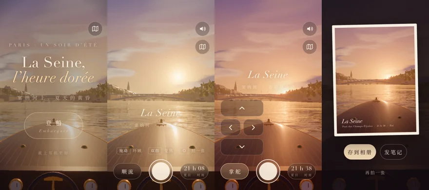

# 开放水域 · Open Waters

在塞纳河上，桥拱的影子慢慢掠过船头。换到挪威，同一片水面映出的是岩壁和瀑布。



Open Waters 是一组可以亲自掌舵的第一人称 3D 航程。选一处水域，登上木船，七分钟里看天色从金黄走到深蓝。每处航区都用程序搭建，沿途的地貌和建筑取材于真实地点，距离和布局经过艺术化编排。

| 航区 | 从船上能看到什么 | 航区 ID |
| --- | --- | --- |
| 法国 · 塞纳河 | 石岸、驳船、亚历山大三世桥，入夜后逐盏点亮的河灯 | `seine` |
| 挪威 · 盖朗厄尔峡湾 | 沿岩面落下的瀑布、坡上的针叶林，天黑后逐扇亮起的木屋窗户与码头灯 | `fjord` |
| 日本 · 濑户内海 | 可绕行的岛屿、带港灯的防波堤、岛间渡轮和悬索桥 | `seto` |



## 本地出航

使用 Node.js 22.12 或更新的 LTS 版本，以及支持 WebGL 2、浮点渲染目标的浏览器。

```sh
git clone https://github.com/carpediemzzsssww-cpu/open-waters.git
cd open-waters
npm ci
npm run dev
```

打开终端打印的本地地址。地址后加 `?voyage=seto` 可以直达濑户内海。需要生成静态站点时运行 `npm run build`，产物在 `dist/`，可用 `npm run preview` 预览。

## 掌舵

登船后会自动巡航。用 **W / S** 增减油门，持续减速可以倒船。**A / D** 接管船舵，**空格**切回巡航。拖动画面环顾，滚轮变焦。手机用屏幕方向键驾驶，双指缩放，点船舵图标切换手动驾驶和巡航。

点日落图标可以调季节、黄昏进度和流速。**T** 暂停时间，**M** 切换声音，**H** 隐藏界面。点地图图标可以换水域，每次换航区从新航区的起点出发。

## 做一片自己的水域

每个航区只负责岸上的世界和水中的障碍物。引擎负责造船、驾驶、天空、水面、倒影和尾迹。长度以米计，水面在 `y = 0`，船头初始指向 `−Z`。

1. 在 `src/destinations/` 新建 `my-bay.ts`。下面这个可运行的例子会在航道一侧立起一块礁石，同时登记它的碰撞范围。
2. 在 [航区目录](src/destinations/catalog.ts) 的 `voyages` 数组中新增一项，填入名称、出发点和航行边界，将 `loadWorld` 指向新模块。
3. 打开 `?voyage=my-bay` 试航。选择入口、直达地址和航行中的目录都会读到新航区。

```ts
// src/destinations/my-bay.ts
import * as THREE from 'three';
import { withAtmo } from '../core/atmosphere';
import { addCollider } from '../world/collide';
import type { Part, Progress, WorldContext } from '../world/build';

export async function build({ scene }: WorldContext, step: Progress): Promise<Part[]> {
  await step('礁石', 0.5);
  const rock = new THREE.Mesh(
    new THREE.SphereGeometry(1, 24, 16),
    withAtmo(new THREE.MeshStandardMaterial({ color: 0x807b70, roughness: 0.95 })),
  );
  rock.scale.set(7, 5, 7);
  rock.position.set(22, 0, -12);
  scene.add(rock);
  addCollider({ x: 22, z: -12, hw: 7, hl: 7, r: 7, yaw: 0 });
  return [];
}
```

```ts
// Add to voyages in src/destinations/catalog.ts
{
  id: 'my-bay',
  name: '小石湾',
  localName: 'Stone Bay',
  region: '自建航区',
  description: '从礁石西侧驶过。',
  navigation: { spawnX: 0, spawnZ: 90, halfWidth: 60, minZ: -200, maxZ: 200 },
  loadWorld: () => import('./my-bay'),
},
```

`waterTint` 调节水体的线性 RGB 乘数，`sunBearing` 调节夕阳相对航向的角度。自动巡航默认沿中轴两侧往返，给它留出一条能掉头的水道。动态场景可在 `build` 返回的数组中放入带 `update(dt, time, camera)` 的对象，`dt` 单位为秒。渡轮的写法见 [濑户内海航区](src/destinations/seto-route.ts)。

峡湾里的灯跟着引擎的黄昏时钟走。可以在 [峡湾场景](src/destinations/fjord.ts) 找到沿岸木屋、发光窗和码头灯，在 [航程更新函数](src/destinations/fjord-route.ts) 看它们怎样随天色渐亮。打开 `?voyage=fjord&dusk=0.79&flow=0&x=56&z=-34&yaw=-43`，可以从船上直接看到这一段岸线。

## 小红书小工具



小工具和网页共用航区、船、水面倒影和尾迹。三个地点全部装进同一个离线 ZIP。点右侧的地图就能换景，一趟黄昏默认五分钟。底部从左到右是顺流／掌舵、快门和时刻。快门将画面排成 1080 × 1440 的明信片，在支持的客户端可以保存、发笔记或分享。支持陀螺仪的客户端上，还可以点右上角的手机图标开关体感环顾。

移动版单独控制岸线和远景的面数。持续掉帧时会降低内部分辨率、关闭泛光，再切换为程序天空倒影。

在已运行 `npm ci` 的项目根目录，将创作服务平台提供的 `minitool-zip-builder` **1.11.1** 解压到 `.codex/minitool-zip-builder/`。也可以把环境变量 `MINITOOL_SKILL_DIR` 指向包含 `SKILL.md` 的目录。打包需要 Python 3。

```sh
npm run build:minitool
npm run serve:minitool
```

第一个命令生成 `release/open-waters-minitool-v1.zip` 和同名的 `.validation.json`、`.validation.md`，记录官方对构建目录和 ZIP 的审计结果、文件大小及 SHA-256。第二个命令在本地提供带严格内容安全策略的预览服务。安装桌面版 Chrome 后，执行 `npm run qa:minitool` 会解开刚打的 ZIP 运行独立的浏览器回归测试，并把结果补进两份校验摘要。发布前再用同一份 ZIP 走创服平台模拟器和 Android、iOS 真机扫码。

## English

Take the same wooden boat down the Seine, into a Norwegian fjord, or between islands in Japan’s Seto Inland Sea. Steer by hand or let the boat cruise through dusk. Each destination is a hand-built interpretation of a place, rendered in real time with procedural geometry, reflected light and synthesized sound. To add a voyage, export a scene builder and register it in the destination catalog.

## License

项目源码使用 [MIT 许可证](LICENSE)。three.js 使用其随包分发的 MIT 许可证。
